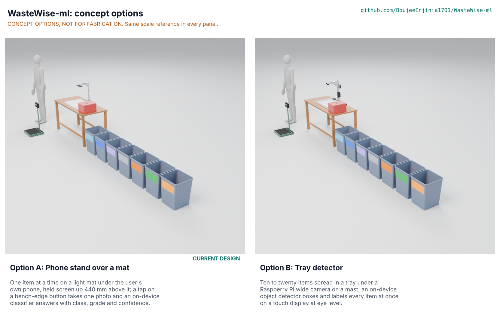

# WasteWise-ml concept options

**Recommendation: option A, the phone stand over a mat (the current design), scores 205 of 255 against 152 for option B, the tray detector, 26 % ahead. The choice is proposed, awaiting Amish** (WML-DEC-001 D1, WML-DDR-004). Option A keeps the user's own phone as the whole computer and camera, sees each item alone and close, and costs about USD 313 a station; option B sorts many items per photo but needs a separate computer, camera and display, sees hazards partly hidden in a pile, and costs about USD 419 without a phone. Method: STANDARDS section 21.

*Figure 1. The two options at one scale, rendered from `cad/src/model.py` (`components("A")` and `components("B")`) by `.kit/options.py`. The options picture is rendered on Amish's Mac with Blender Cycles and is not yet in the repository.*

## The options

Both options are image classifiers that run offline at the sorting bench, with the same seven bins, hazard box, scale and per-site grade file. They differ in how items reach the camera and how the answer reaches the user, which changes what the model must do (classify one item, or find and classify many).

### Option A: phone stand over a mat (current design)

**Working principle.** One item at a time on a light mat under the user's own phone, held screen up 440 mm above it; a press of a Bluetooth shutter button at the bench edge takes one photo and an on-device classifier answers with class, grade and confidence, or "Unsure" or "Hazard".

This is the design carried to TRL 3 (WML-PRC-001, WML-BLD-001). A plywood board clamped to the bench's back edge carries a 25 x 25 x 2 mm aluminium post and arm; the phone lies in a folded tray with its camera bump in a window, 440 mm above a sealed hardboard mat that the board places so the picture (586 x 439 mm) falls on the mat. A MobileNetV3-Large classifier of about 4.4 MB answers in 64 to 201 ms. The result fills the screen in the class colour with the bin number at least 40 mm tall and is spoken by default (fix F1). One item is handled per photo, so the user scans only the items she is unsure of. The model is detailed to D3 with 101 parts (58 made or bought, 43 fasteners).

**Key risks.** Dataset size and coverage rest on assumed learning curves (WML-STM-001 M4, M5); the camera cannot grade opaque HDPE against PP or black plastics (PR-002 not met); the picture fits the mat with 2.0 mm to spare after the phone's placement in the tray, only for a lens of 25.76 mm equivalent or longer (PR-019 at risk; lens at 420 mm proposed to Amish, D2); the photo-to-result time is over 300 ms if a full 12 MP frame is decoded (PR-005 at risk). **Needs from a co-design partner:** the buyers' grade list, bench heights and a site for field photos.

### Option B: tray detector

**Working principle.** Ten to twenty items spread in a tray under a Raspberry Pi wide camera on a mast; an on-device object detector boxes and labels every item at once on a touch display at eye level.

A 40 x 40 x 2 mm aluminium mast and arm on a clamped board hold a Raspberry Pi Camera Module 3 Wide (102 x 67 degrees) 450 mm over a 600 x 400 mm polypropylene tray, so the camera sees 1,111 x 596 mm. A Raspberry Pi 5 in a printed case on the mast runs a YOLO-class detector (about 0.9 to 1.7 s a photo) and shows the tray with a coloured box and bin number on each item on a 5 inch display at about 1,150 mm; an arcade push button at the bench edge takes the photo. A 20,000 mAh power bank runs it for a shift (about 54 % of its energy). The model is detailed to D3 with 116 parts (69 made or bought, 47 fasteners).

**Key risks.** Hazards partly hidden under other items in a crowded tray (WML-STM-001 OB5, untested); the wide lens sees hands and people beyond the tray, which makes the consent and no-faces rule (PR-014) harder; the common YOLO implementations are licensed AGPL-3.0, which does not fit MIT weights, so another detector would be needed; every item is picked into the tray and spread out, which adds handling of sharps; the station costs about USD 106 more than option A, although A's figure includes a USD 130 reference phone that a user's own phone can replace. **Needs from a co-design partner:** whether pickers would spread items in a tray at all, and a site with power for daily charging.

## First-order numbers

Table 1. Options compared (WML-CAL-001 sections 5, 10 and 15; `cad/fidelity.json`).

| Quantity | Option A: phone stand over a mat | Option B: tray detector |
| --- | --- | --- |
| Estimated station cost (USD) | 313.39 (BOM lines 1 to 7, 11, 12; includes a USD 130 reference phone) | About 418.90 (cited Pi 5, camera and display prices plus estimates; no phone) |
| Station mass, model (kg) | 38.5 (bins, hazard box with sand and scale included) | 39.2 |
| Output or throughput | One item a photo, 0.9 to 2.0 s place-to-result; only items the user is unsure of are scanned | About 15 items a photo, 0.9 to 1.7 s of detector time (at worst about 0.12 s an item) |
| Energy or effort | 1.4 Wh a shift, 9 % of the phone battery; about 72 h to label 10,000 photos | About 34 Wh a shift from a 20,000 mAh bank; about 98 h to label 10,000 item instances with boxes |
| Parts count (model) | 101 (58 made or bought, 43 fasteners) | 116 (69 made or bought, 47 fasteners) |
| STEM check | Within known science after fixes F1 to F3 and F5; S2, M2, M4, M5, B2, C3 and E4 open (field data, trials, D2) | Within known science on optics, power and speed; OB5 open (hazards in a crowded tray) |

## Scoring

Table 2. Weighted scoring (weights: High UR 3, Medium 2, Low 1; scores 1 to 5).

| Criterion | Source | Weight | A | B | Reason |
| --- | --- | --- | --- | --- | --- |
| Right material class | UR-001 | 3 | 4 | 3 | A sees one centred item close up; B sees many smaller, sometimes overlapping items |
| Buyer's grade | UR-002 | 3 | 3 | 2 | A resolves 0.15 mm a pixel and can read molded codes; B's detector input is 0.87 mm a pixel |
| Hazards flagged | UR-003 | 3 | 4 | 2 | A sees each item alone; in B a battery under a bottle can be missed (OB5) |
| Honest unsure | UR-004 | 3 | 4 | 3 | Abstaining per item is simple in A; in B a missed detection gives no "Unsure" at all |
| Fast | UR-005 | 3 | 3 | 5 | B labels about 15 items a photo; A one |
| No reading needed | UR-006 | 3 | 3 | 4 | B's display faces the user at eye level; A's flat screen needs the full-screen colour and voice of F1 |
| Hands free, no stretching | UR-007 | 3 | 4 | 3 | Both trigger at the bench edge; B adds picking every item into the tray and spreading it |
| My own phone, offline | UR-008 | 3 | 5 | 1 | A runs on the user's phone; B needs a Pi, camera and display |
| Lasts a shift | UR-009 | 2 | 5 | 3 | A uses 9 % of the phone battery; B needs a large power bank charged daily |
| Our grade names | UR-010 | 3 | 5 | 5 | Same per-site grade file |
| Our data, our consent | UR-011 | 3 | 4 | 3 | A's frame is the mat; B's 102 degree lens sees hands and people beyond the tray |
| Open and licensed | UR-012 | 2 | 5 | 3 | Common YOLO implementations are AGPL-3.0, not MIT |
| Proven on real waste | UR-013 | 2 | 4 | 3 | A's evaluation set needs labels only; B's needs a box on every item |
| Build it locally | UR-014 | 2 | 4 | 3 | B adds electronics assembly and printed parts |
| Works in our shed | UR-015 | 2 | 4 | 3 | A's phone is sealed; B's Pi sits in a vented case in dust and heat |
| Low cost | UR-016 | 2 | 4 | 2 | About USD 313 against about USD 419 without a phone |
| Easy to keep going | UR-017 | 1 | 4 | 3 | A's phone lifts out; B adds a memory card, a cooler and more cables |
| Cost against the value-engineering target | `budget_usd` null; scored on estimated cost | 2 | 4 | 2 | As UR-016; no target is set in this software repository |
| Buildable with local skills and tools | WML-BLD-001 | 2 | 4 | 3 | A needs a saw, a drill and files; B also needs a 3D printer and careful assembly of the Pi, camera and display |
| Safety | WML-RSK-001 | 3 | 4 | 3 | B adds handling of sharps into the tray and a larger lithium pack |
| Maintenance | | 1 | 4 | 3 | Fewer parts and no memory card in A |
| **Weighted total** | | 51 | **205** | **152** | Out of 255 |

## Recommendation

**Option A, proposed, awaiting Amish.** It scores 205 against 152 (26 % ahead, well outside the 10 % band, so a recommendation is made). It is the current design, so choosing it changes nothing in the repository. Option A wins on the user's own phone, hazard safety, cost and openness; option B wins only on throughput and on where the display sits.

**The runner-up's best ideas to graft onto A:** B's bench-edge trigger is already in A (the shutter button of fix F1). B's throughput, many items a photo, can come later as a software mode on the same phone stand: a detector that finds several items on the mat at once, trained only once the field data exist and with a detector whose license fits MIT. That is a later decision, not part of this upgrade.

The recommendation is recorded in the design decisions register (WML-DEC-001 D1) and argued in WML-DDR-004. `project.yaml` lists `concept_options: [A, B]` and leaves `concept_chosen` as "A (proposed)" until Amish decides.
